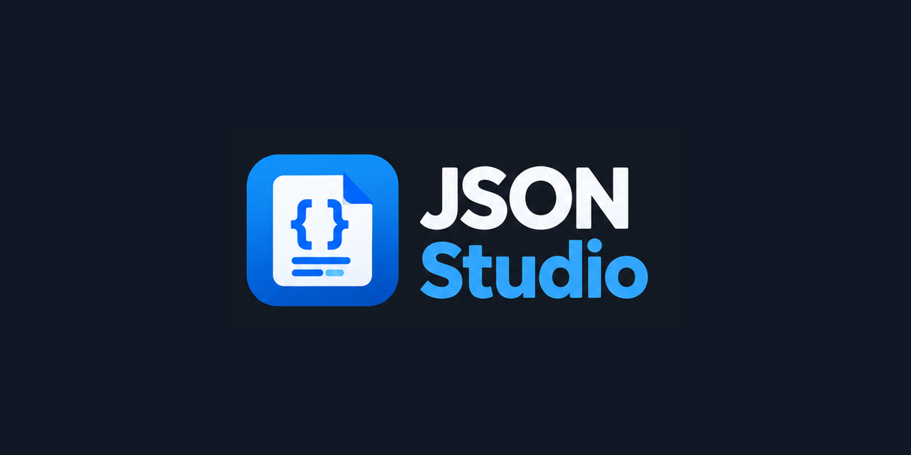

# JSON Studio



A Swiss Army knife for JSON in VS Code. View, edit, repair, query, reshape, convert and compare JSON without leaving the editor.

## Open it

- Click the split-view icon in the editor title bar of any `.json` file (**Open JSON Studio to the Side**).
- Or right-click a file in the Explorer and choose **Open in JSON Studio**, or use **Reopen Editor With… → JSON Studio**.
- To make it the default for JSON, add `"workbench.editorAssociations": { "*.json": "jsonStudio.editor" }` to your settings.

JSON Studio edits the real file. Every change from the tree or table is a normal text edit, so undo/redo, dirty state, save, git and your comments all keep working. Keep the text editor open beside it and the two stay in sync: selecting a node highlights its text, and moving the cursor selects the node.

## Features

### View and beautify
- Virtualized tree that handles large files. Collapse to depth 1/2/3 or expand everything (Alt+click a node to expand or collapse its whole subtree).
- Collapsed nodes show a one-line preview of their contents.
- Breadcrumbs and node/depth/size statistics.
- **Beautify** (keeps comments), **Minify** and **Sort keys** (recursive). The indent is set by `jsonStudio.indent`.
- The status bar shows the JSONPath under the cursor; click it to copy the path as JSONPath, JavaScript, jq, JMESPath or JSON Pointer.

### Repair broken JSON
Fixes trailing commas, single quotes, unquoted keys, comments, missing commas or brackets, Python `True`/`None`, NDJSON, JSONP wrappers and Markdown code fences. You always see a diff preview before anything changes. Repair is available from the toolbar, the command palette, and as a quick fix (💡) on any syntax error. While a file is broken, JSON Studio shows a read-only preview of the repaired data.

### Search, query and filter
One query bar with four languages:

| Mode | Example |
|---|---|
| Text / regex | `isbn` (match case, whole word, regex; keys, values or both) |
| JSONPath | `$..book[?(@.price < 10 && @.tags)].title` |
| JMESPath | `store.book[?price > \`10\`].{title: title, by: author}` |
| jq | `.store.book[] \| select(.price < 10) \| {title, author}` |

- Results update as you type. Press **Enter** to also save the query to history.
- **Filter tree** shows only the matches and their parents (Text and JSONPath).
- **From selected node** runs the query against the selected subtree only.
- **Use selected path** fills the query with the selected node's path.
- The **?** button lists examples, **⏱** shows recent queries and **☆** saves the current one.

### Table view and editing
- Opens any array of objects, or an object of objects, as a grid. The first array found is chosen automatically, or use "Open as table" on any node.
- Sort by clicking a column header. Filter per column (text contains, or `>10`, `<=3`, `=x`, `!=x`) or across all columns.
- Resize and drag-reorder columns, and hide them.
- **Flatten nested** shows nested objects as `a.b.c` columns. Nested arrays of objects open as their own table (↳).
- Double-click or press Enter to edit a cell; values keep their type. Add, insert, duplicate and delete rows. Add, rename and delete columns, which applies to every row.
- Keyboard: arrow keys and Tab move between cells, Enter edits, Delete sets a cell to null, Cmd/Ctrl+C copies a cell.
- **Export ▾** copies as TSV (paste straight into Excel or Sheets), or exports JSON, CSV or YAML to a new tab or a file.

### Save query results
From the results panel:
- **Open in new tab:** an untitled JSON document.
- **Save / Export:** to a JSON, CSV or YAML file, or open as CSV or YAML.
- **Copy** the result.
- **Replace document with result** (can be undone).

Results can also be viewed as a table.

### Transform toolkit
Flatten/unflatten, remove nulls, remove empty values, dedupe arrays, sort an array by key (use `-key` for descending), sort keys, escape to a string or unescape a string, and **decode embedded JSON** (string values that contain JSON). Every transform runs on the selected node or the whole document.

### Convert and generate
- Convert JSON to YAML, CSV, TSV, XML or TOML, and YAML/CSV/XML/TOML back to JSON. CSV columns like `a.b` become nested objects.
- **Generate types** from sample data: TypeScript, TypeScript + Zod, Go, Python, Rust, Java, C#, Kotlin, Swift or Dart.
- **Infer a JSON Schema** from sample data.

### Validate and diff
- **Validate against a JSON Schema** (draft-07, 2019-09 or 2020-12) from the document's `$schema`, the `jsonStudio.schema.path` setting, a file or a URL. Problems appear in the Problems panel on the exact keys and values, and update as you type.
- **Semantic diff** with another file or the clipboard. Key order is ignored, and array items are matched by `jsonStudio.diff.arrayIdKey` (default `id`). It shows a side-by-side diff of the normalized documents, a list of changes, and an RFC 6902 **JSON Patch** export.

## Settings

| Setting | Default | |
|---|---|---|
| `jsonStudio.indent` | `"2"` | `2`, `4` or `tab` |
| `jsonStudio.schema.path` | `""` | Schema used when the document has no `$schema` |
| `jsonStudio.diff.arrayIdKey` | `"id"` | Key that matches array items in a diff; empty = by position |
| `jsonStudio.queryHistorySize` | `30` | Number of recent queries kept |

## Development

```bash
npm install
npm run build          # extension (esbuild) + webview (Vite)
npm test               # unit tests (vitest)
npm run test:integration   # smoke tests inside VS Code
npm run package        # build a .vsix
```

Press **F5** to launch an Extension Development Host with `test/fixtures` open. Run `node test/fixtures/generate-large.mjs` to create a 5,000-row file for testing the table.

Layout: `src/core` holds the pure, unit-tested logic (parse, edit, query, transform, convert, schema, diff). `src/extension` is the VS Code host. `webview/` is the React UI.
